# Nodexia

> **Single-binary control plane for server fleet telemetry, bandwidth forecasting, SSH operations, and Rebecca / PasarGuard node management.**

[](https://github.com/Ho3einK84/Nodexia/releases)
[](https://go.dev/)
[](LICENSE)
[](FRONTEND.md)

Nodexia connects to Linux servers over SSH, collects system and `vnStat` traffic metrics on a configurable schedule, forecasts monthly bandwidth consumption against provider billing cycles, discovers and deploys VPN proxy nodes, and routes alerts to Telegram—all served from a responsive, bilingual (**English LTR / فارسی RTL**) Dark Graphite web workspace compiled into a single static Go binary.

---

## Key Capabilities

- **Fleet Telemetry & Forecasting:** Real-time CPU, RAM, swap, disk, load averages, hourly/daily metric rollups, minimal Bento layouts with 3-column micro-gauges optimized for mobile screens, host specification cards with animated uptime indicators and one-click copy, plus a color-coded **Analytics** workspace (layered dark-slate surfaces, 4-tile fleet KPI strip with monthly fleet traffic & RX/TX split, resource health meters & dual-tone stacked traffic bars that adapt into responsive cards on mobile, interactive gradient SVG charts with pulsing live beacons, touch scrubbing, series legend toggles, sliding `1H` / `24H` / `7D` / `30D` range tabs, and quota exhaustion trajectory bars calibrated to billing reset days).
- **Node Discovery & Deployment:** Single-flight SSH discovery of Docker and systemd **Rebecca** and **PasarGuard** nodes, atomic snapshot tracking, 30-day UTC uptime strips, confidence & latency telemetry, interactive quick-action menus with outside-tap dismiss, unified Dark Graphite Properties, Node Update, and in-page **Add Server** modals (with live SSH test, smart paste, and tag chips), read-only SSH config inspection, live streaming log drawer, and a guided 3-step deploy wizard with preflight checks and secure PTY installs.
- **Built-In Ops Suite:** Multi-pane workspace featuring an in-browser SSH WebSocket terminal (`xterm.js` with Termius-style smart command autocomplete, learned history, vector mobile controls, `/tmp` upload, and Dark/Light themes), SFTP file browser and inline code/config/log-tail editor, SSE command runner, and bulk batch tasks.
- **Alerting & Operational Diagnostics:** Configurable threshold, predictive quota, anomaly, and host-down rules with per-server silences and Telegram digests; live runtime diagnostics (`/ops/diagnostics`), Kubernetes-style health probes (`/healthz`, `/healthz/live`, `/healthz/ready`), Prometheus exporter (`/metrics`), and AES-256-GCM encrypted backup/restore.
- **Zero-Build Multi-Tab Workspace:** Open multiple servers, terminals, and analytics panes side by side without page reloads using browser-native ES Modules (`app.js` + 4 core modules `core.js`, `ui.js`, `modals.js`, `shell.js` and 5 lazy-loaded domain modules `stream.js`, `log-drawer.js`, `nodes.js`, `nodes-deploy.js`, `server-modal.js`), pure Dark Graphite CSS design tokens, strict 60fps smoothness guardrails (zero `backdrop-filter`, zero `transition: all`, strictly scoped Lucide icons), intuitive server subnav ordering, and Go `embed.FS` SHA-256 asset fingerprinting—zero `npm` or bundler pipelines.
- **Security Hardened:** Single-administrator session auth, rate-limited login, HMAC synchronizer CSRF tokens, TOFU SSH host-key pinning, external credential references (`env:` / `file:`), and strict CSP (`script-src 'self'`, `frame-ancestors 'none'`).

---

## Interface Gallery (`v0.9.2`)

> **Note:** The gallery screenshots below were captured on `v0.9.2` (prior to the `v0.9.3` unified Dark Graphite UI refactor and the `dev` Analytics color & motion redesign).

### Overview & Bilingual RTL Workspace
Unified fleet summary, active warning banners, resource snapshots, and full bidirectional English / Persian (فارسی) layout parity.

| Operations Overview (EN) | Operations Overview (FA RTL) |
| :---: | :---: |
| 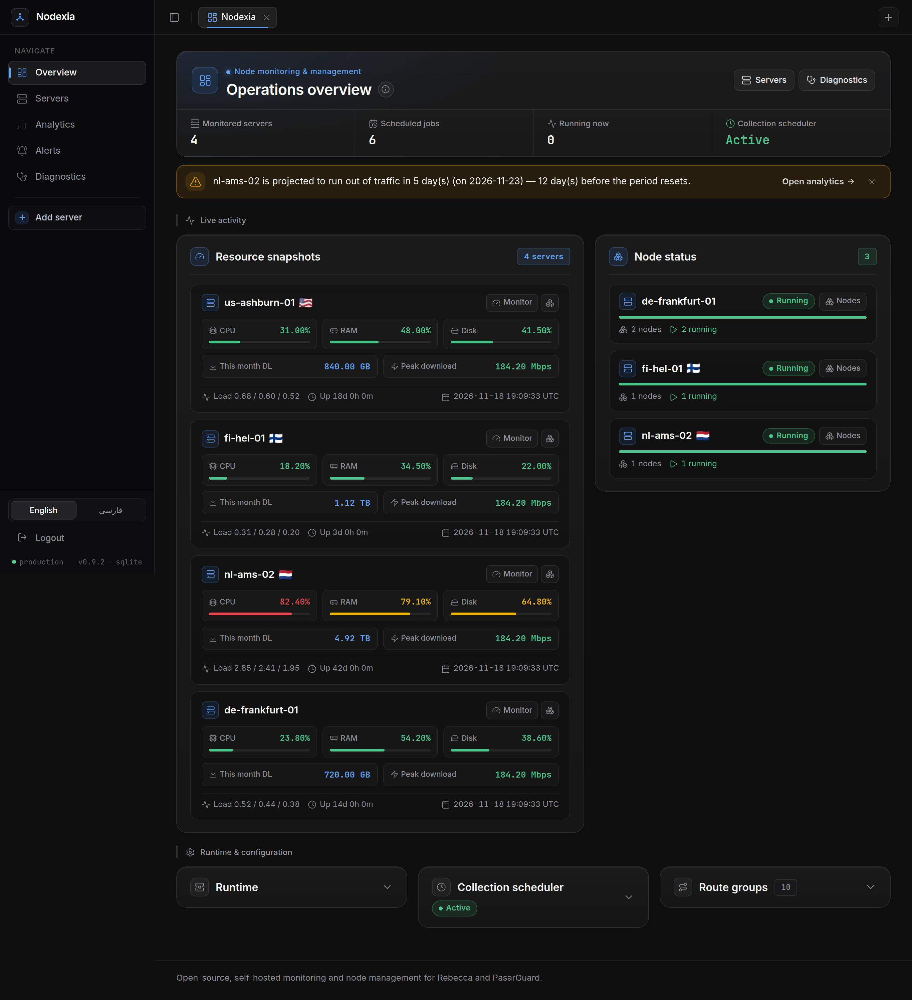 | 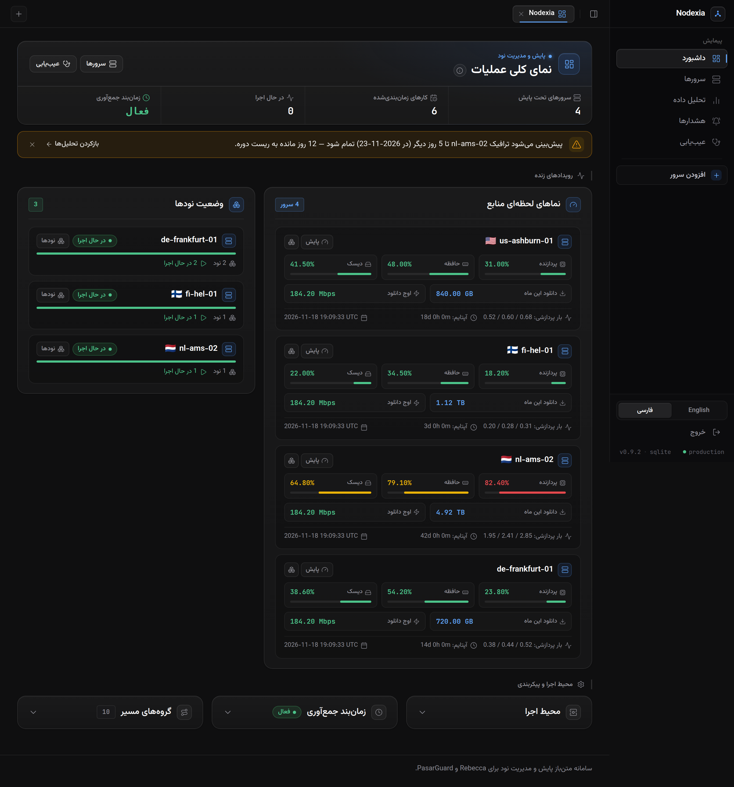 |

### Server Registry & Node Fleet Management
Searchable, label-filtered server inventory with live CPU/RAM/Disk telemetry and quick actions alongside the Dark Graphite Nodes command center, 30-day UTC uptime strips, and deployment controls.

| Server Registry | Nodes Workspace &amp; 30d Uptime |
| :---: | :---: |
| 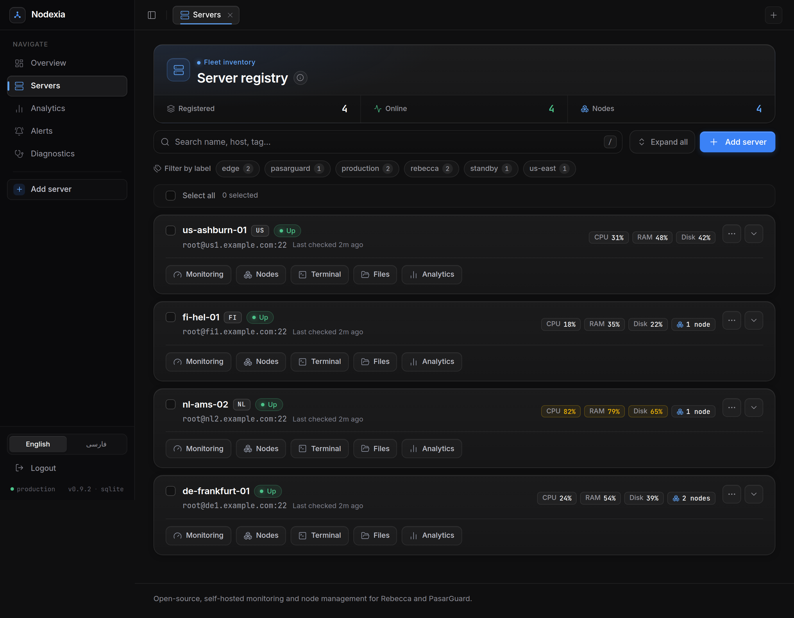 | 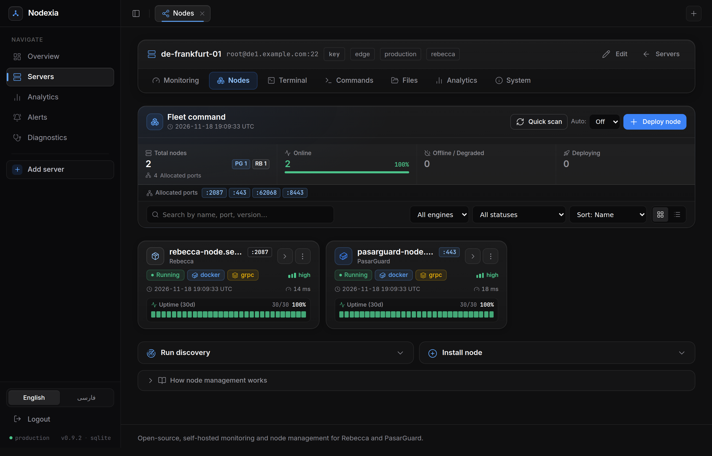 |

### Live Monitoring & Bandwidth Forecasting
Live SSH resource gauges paired with `vnStat` daily/monthly breakdowns and predictive exhaustion alerts calibrated to monthly billing reset days.

| Live Server Monitoring | Exhaustion Forecast Warning |
| :---: | :---: |
| 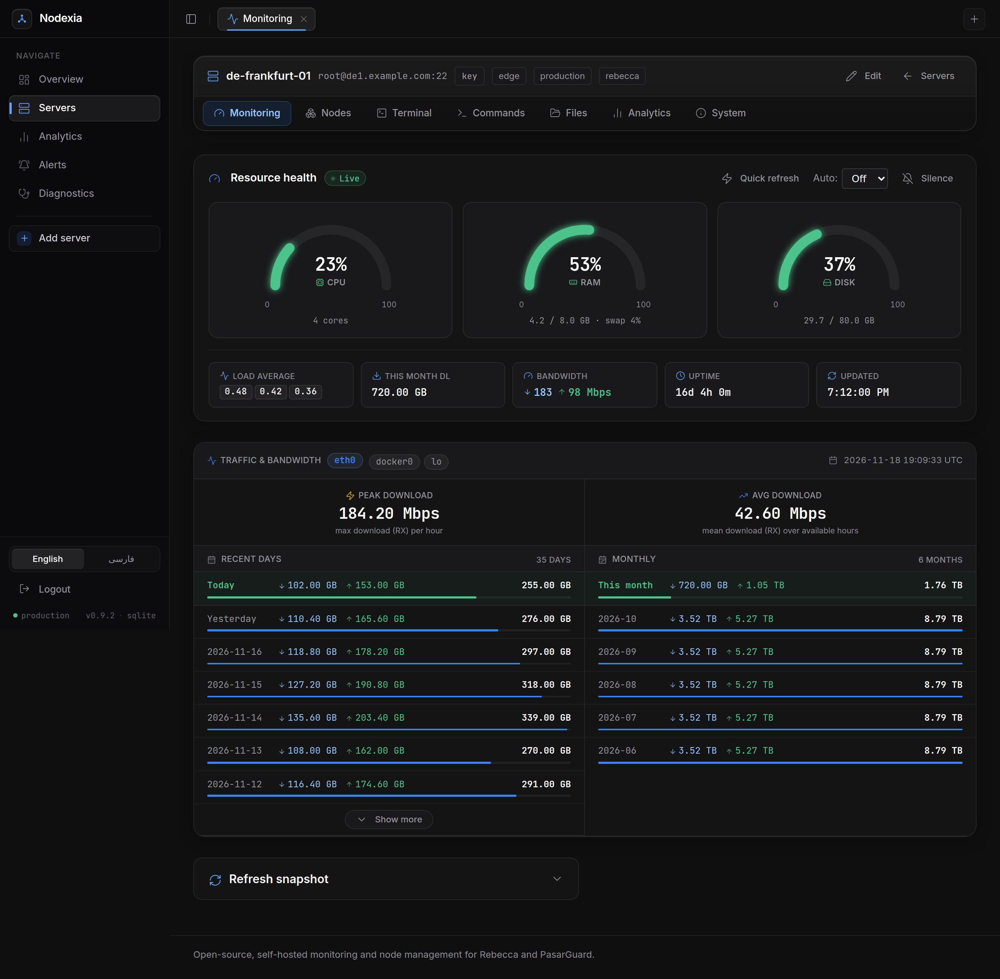 | 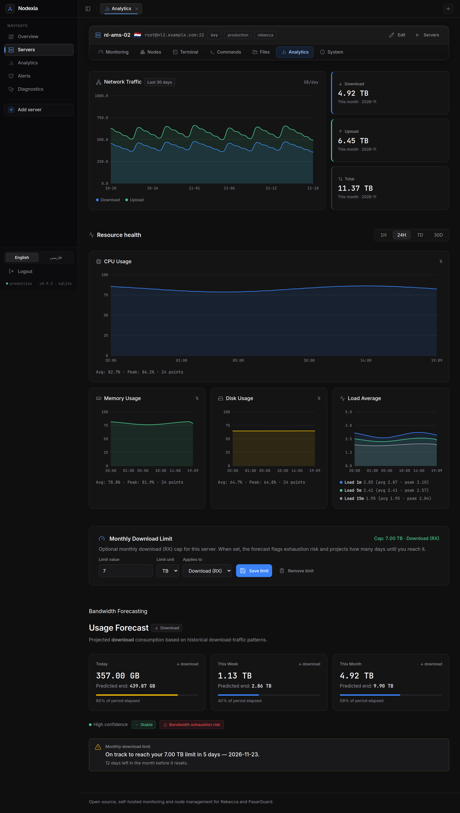 |

### Web SSH Terminal & SFTP File Manager
Interactive WebSocket terminal with Termius-style smart command autocomplete and learned history alongside a full-featured SFTP file browser and inline editor.

| Web SSH Terminal &amp; Autocomplete | SFTP File Browser |
| :---: | :---: |
| 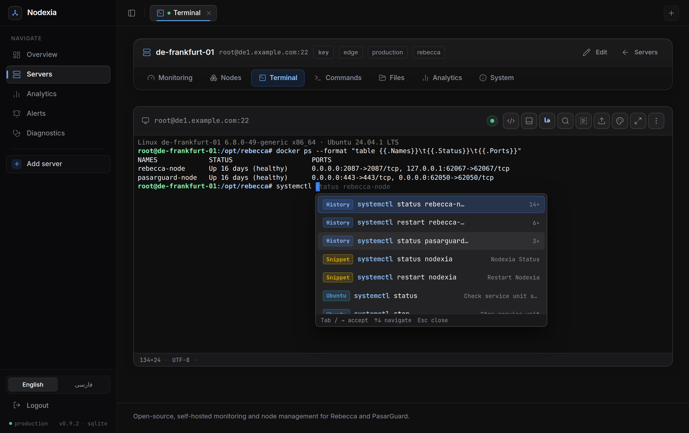 | 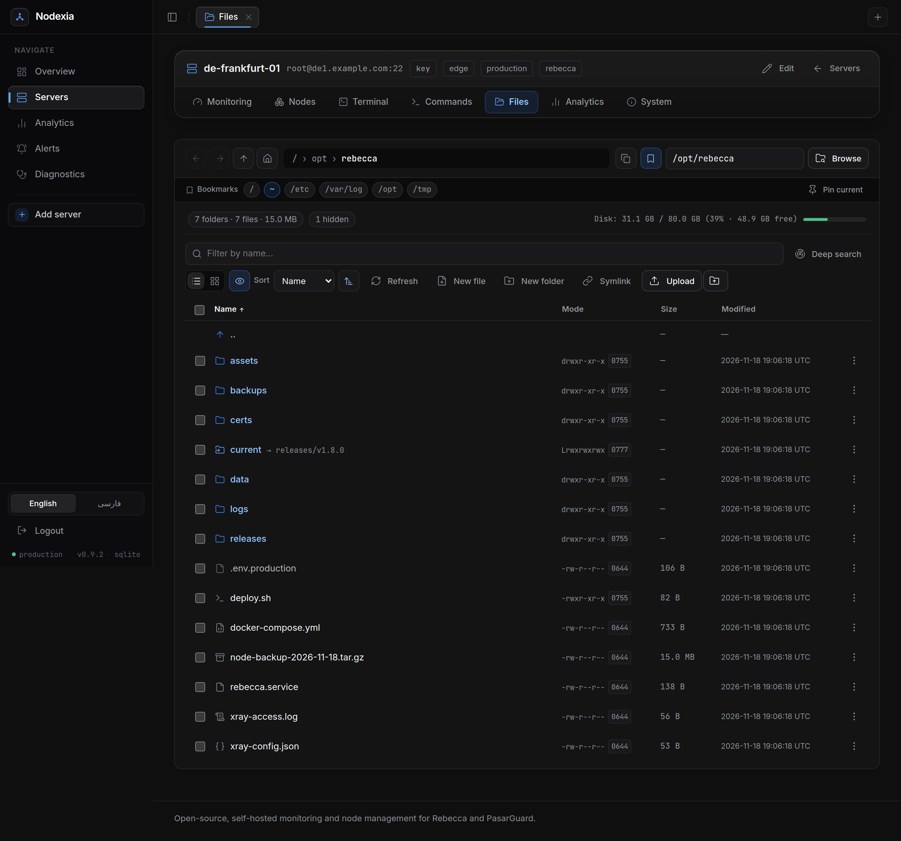 |

<details>
<summary><strong>More views: Inline Config Editor, Healthy Quota, Alerting, Diagnostics, Mobile UI &amp; Login</strong></summary>

| Inline Code &amp; Config Editor | Healthy Quota Trajectory |
| :---: | :---: |
| 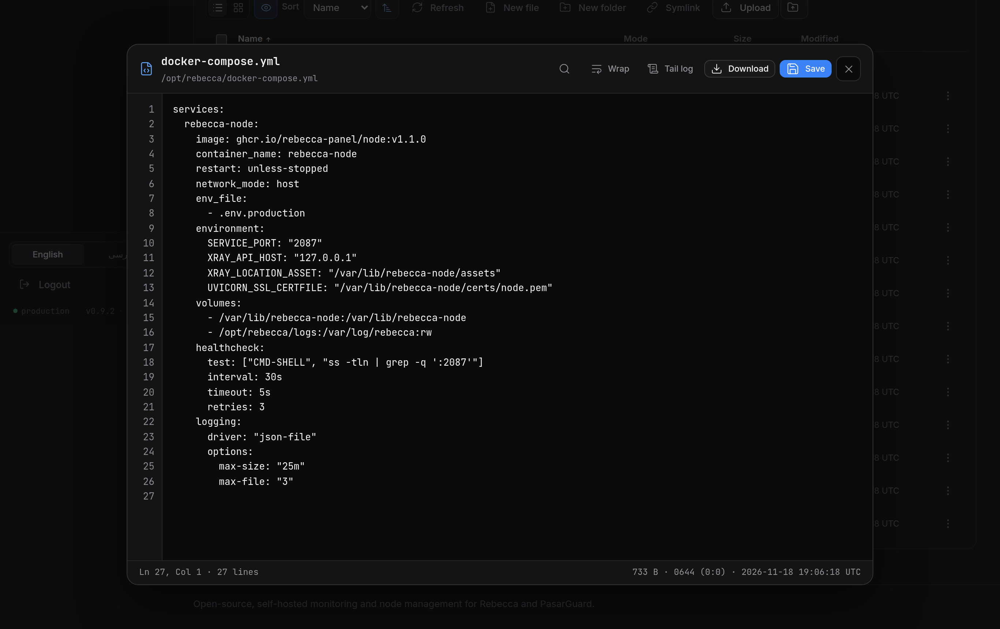 | 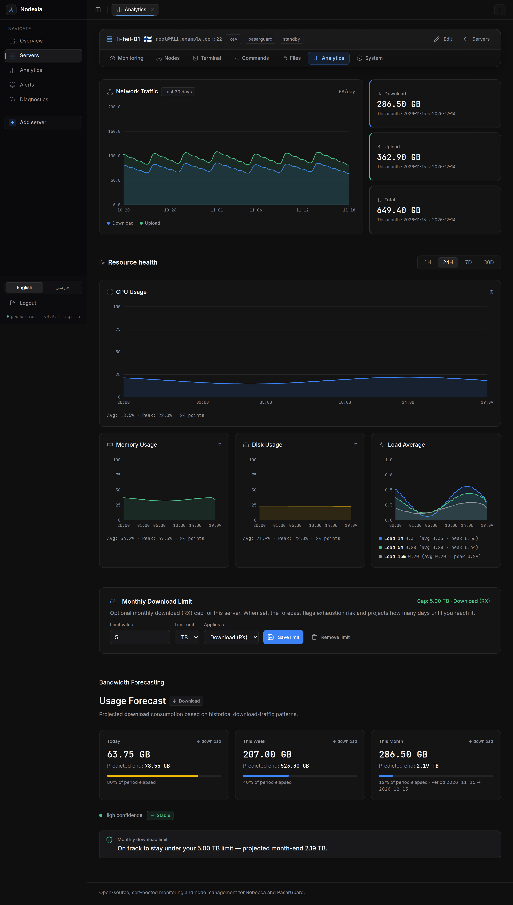 |

| Alerting &amp; Telegram Channels | Operational Diagnostics &amp; Backup |
| :---: | :---: |
| 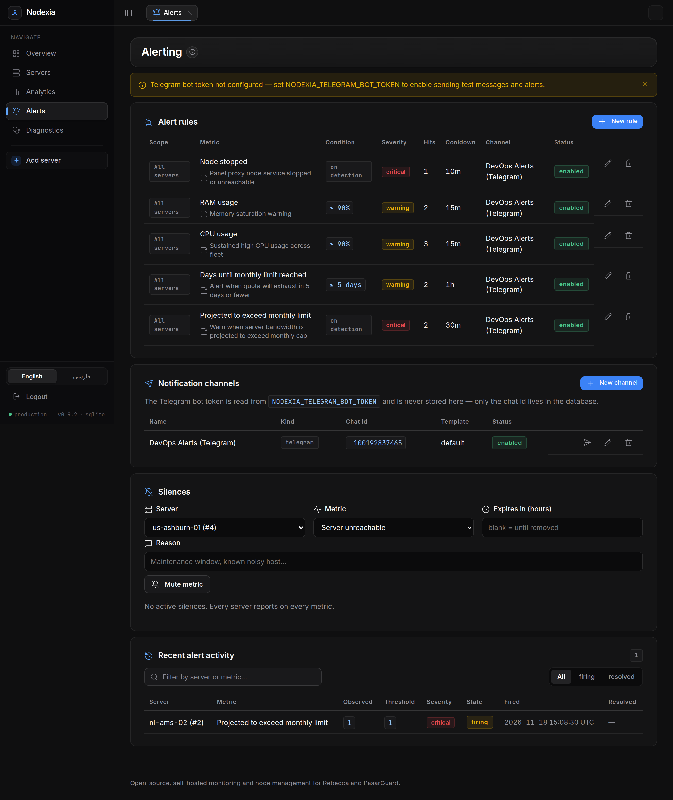 | 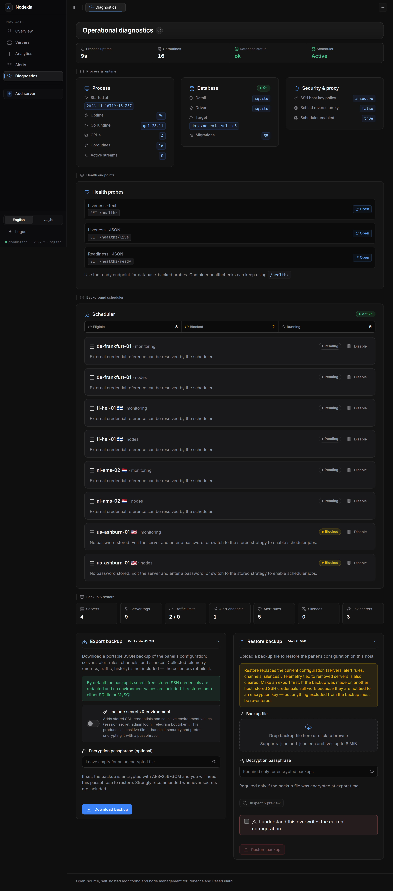 |

| Mobile Nodes Workspace | Mobile SFTP Workspace |
| :---: | :---: |
| 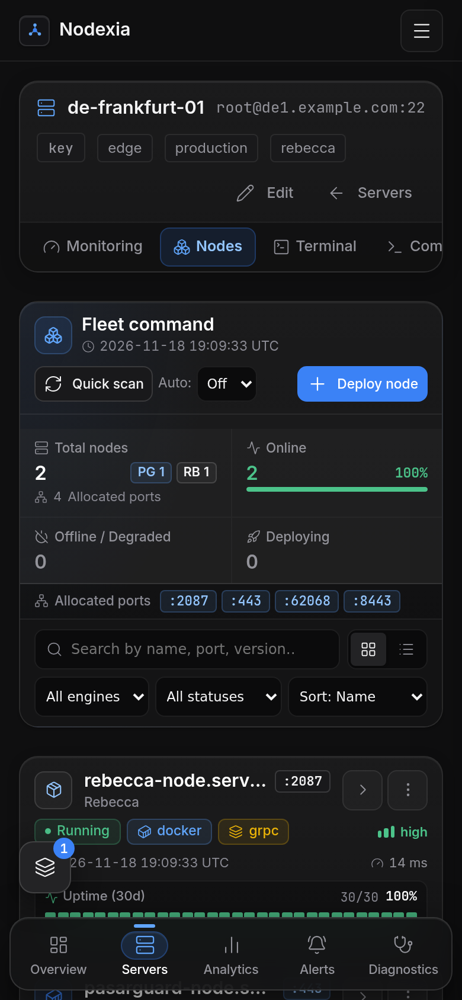 | 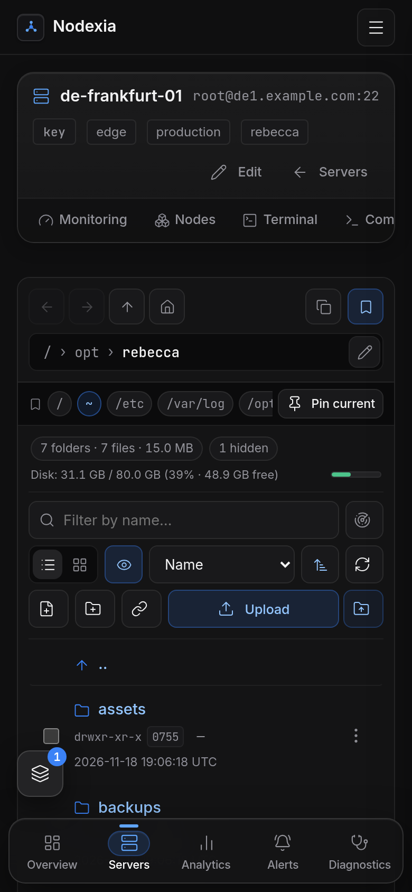 |

<p align="center">
  <strong>Kinetic Dark Graphite Login</strong><br><br>
  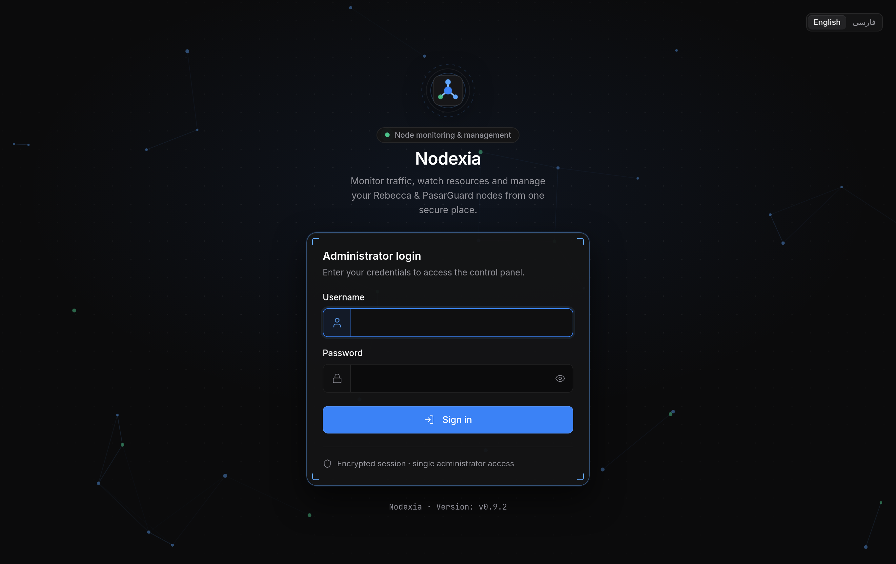
</p>

</details>

---

## Architecture at a Glance

| Layer | Technology | Implementation |
|---|---|---|
| **Backend** | Go 1.26+ | Standard library `net/http` routing and middleware chain (`Recover` -> `Logging` -> `RequireAuth` -> `CSRF` -> `Session` -> `Locale`) |
| **Database** | SQLite / MySQL 8+ | Embedded pure-Go SQLite (`modernc.org/sqlite`) default via shared `db.DBTX`; optional MySQL driver |
| **Frontend** | Zero-Build Web Standards | Server-rendered Go `html/template` partials + modular ES Modules (`core.js`, `ui.js`, `modals.js`, `shell.js` + lazy `stream.js`, `log-drawer.js`, `nodes.js`, `nodes-deploy.js`, `server-modal.js`) + 5-layer CSS design tokens |
| **Remote Ops** | SSH / SFTP / WebSocket | `golang.org/x/crypto/ssh` pooled runtime (`BatchSession`), `pkg/sftp`, and `coder/websocket` paired with vendored `xterm.js` + smart autocomplete |
| **Packaging** | Single Static Binary | Templates, locales (`en.json`, `fa.json`), fonts, and static assets embedded via `go:embed` (`CGO_ENABLED=0`) |

---

## Quick Install (Ubuntu 24.04)

Deploy Nodexia in minutes with Docker Compose and [Caddy](https://caddyserver.com/) automatic HTTPS:

```bash
git clone https://github.com/Ho3einK84/Nodexia.git
cd Nodexia
sudo ./install.sh --domain panel.example.com --email you@example.com
```

> **Unattended installation:** pass `--non-interactive` to auto-generate cryptographically random admin credentials and session secrets.

### CLI Management

The installer provisions a system-wide `nodexia` helper command:

```bash
nodexia status                 # Check container health and runtime status
nodexia logs -f                # Follow live application logs
nodexia restart                # Restart the compose stack
nodexia update                 # Pull the latest release image/binary while keeping config
nodexia uninstall --purge      # Remove containers, volumes, and local data
```

---

## Essential Configuration

Environment variables are stored in `/opt/nodexia/.env.production` for production stacks or `.env` locally (see [`.env.example`](.env.example) and [`.env.production.example`](.env.production.example)):

| Variable | Purpose | Default / Requirement |
|---|---|---|
| `NODEXIA_AUTH_USERNAME` | Administrator username | Required |
| `NODEXIA_AUTH_PASSWORD` | Administrator password | Required |
| `NODEXIA_SESSION_SECRET` | Random secret for HMAC session & CSRF signing | Required (32+ chars) |
| `NODEXIA_DOMAIN` | Public domain name for Caddy TLS | Required in production |
| `NODEXIA_DB_DRIVER` | Database backend (`sqlite` or `mysql`) | `sqlite` |
| `NODEXIA_TELEGRAM_BOT_TOKEN` | Telegram bot token for alerts and digests (env-only) | Optional |
| `NODEXIA_DIGEST_ENABLED` | Enable scheduled Telegram traffic & alert digests | `false` (`24h` interval) |
| `NODEXIA_METRICS_TOKEN` | Bearer/query token enabling Prometheus `/metrics` | Disabled when empty |

---

## Workspace Shortcuts & Documentation

Desktop multi-tab navigation supports layout-independent (`event.code`) shortcuts:
`Alt+T` New tab · `Alt+W` Close tab · `Alt+P` Pin tab · `Alt+Shift+→/←` Next/Previous tab · `Alt+Shift+T` Reopen closed tab · `Alt+1..8` Jump to tab · `Ctrl+K` / `/` Quick filter.

Further engineering guides:

- [**Frontend Architecture (`FRONTEND.md`)**](FRONTEND.md) — Zero-Build conventions, CSS layering, ES modules, and template partials.
- [**System Architecture (`docs/architecture.md`)**](docs/architecture.md) — Module interface, middleware pipeline, database invariants, and security model.
- [**Nodes Module (`docs/nodes.md`)**](docs/nodes.md) — Rebecca & PasarGuard discovery flow, 30-day UTC uptime buckets, PTY installs, and HTTP routes.
- [**Multi-Tab Workspace (`docs/tab-system.md`)**](docs/tab-system.md) — Pane scoping, lifecycle events, and mobile drawer/gesture adaptations.
- [**Contributing Guide (`CONTRIBUTING.md`)**](CONTRIBUTING.md) — Repository rules, test expectations, and PR conventions.

---

## Local Development

```bash
cp .env.example .env
go run ./cmd/nodexia/
```

Run verification and build a standalone binary:

```bash
make test              # Run unit and integration tests (go test ./...)
go test -race ./...    # Run suite with race detector
go vet ./...           # Static analysis check
make build             # Build static binary to bin/nodexia
```

Open `http://localhost:8080` in your browser.

---

## License

[MIT License](LICENSE) © 2026 Ho3einK84
